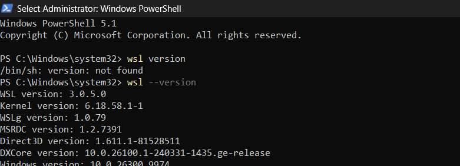
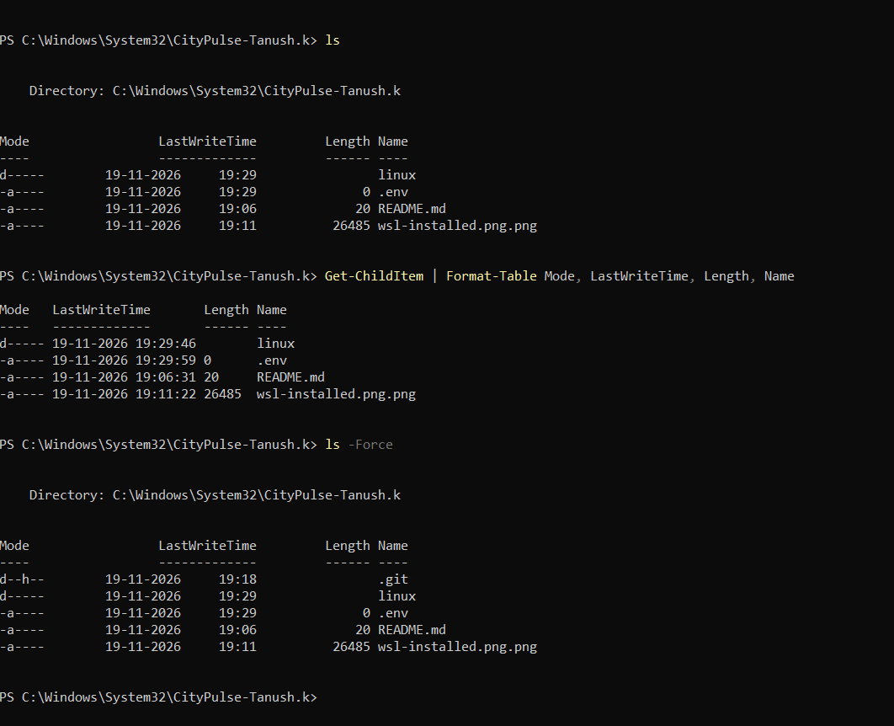

# CityPulse-Tanush.k

A small hands-on workspace for practicing Linux command-line basics through
Windows Subsystem for Linux (WSL). The exercises cover checking the WSL
installation, listing files and directories, viewing hidden items, formatting
directory output, and navigating the repository from PowerShell.

## Requirements

-  Windows 11
- Windows Subsystem for Linux (WSL) installed
- A Linux distribution configured in WSL
- PowerShell

## Getting started

Open PowerShell in this repository and enter the WSL environment:

```powershell
wsl
```

You can also run WSL commands and Linux commands directly from PowerShell:

```powershell
wsl --version
wsl ls -l
```

From PowerShell, inspect this repository with:

```powershell
ls
Get-ChildItem
Get-ChildItem -Force
```

## WSL setup

Check the installed WSL and kernel versions:

```powershell
wsl --version
```

Check whether the WSL distribution has an available shell:

```powershell
wsl
```

## Command exercises

### List files and directories

```powershell
ls
```

`ls` lists the visible files and directories in the current location.

### Show all items, including hidden items

```powershell
Get-ChildItem -Force
```

The `-Force` parameter shows hidden files and directories as well.

### Format directory output

```powershell
Get-ChildItem | Format-Table -Mode,LastWriteTime,Length,Name
```

This displays selected file and directory properties in a table.

### Continue listing with long output

```powershell
Get-ChildItem -Force
ls -Force
```

Both commands help inspect normal and hidden repository items.

## Screenshots

### WSL installation and version



### Repository directory and command output



## Repository contents

- `linux/` - Linux command practice files
- `linux/data.txt` - practice text file
- `wsl-installed.png.png` - WSL version screenshot
- `linux-commands.png.png` - PowerShell and Linux command screenshot
